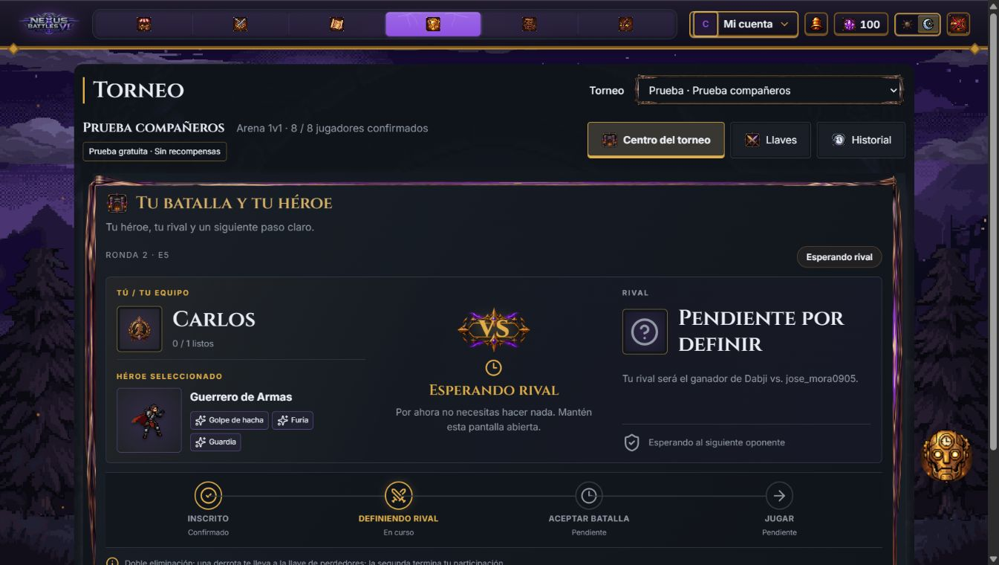
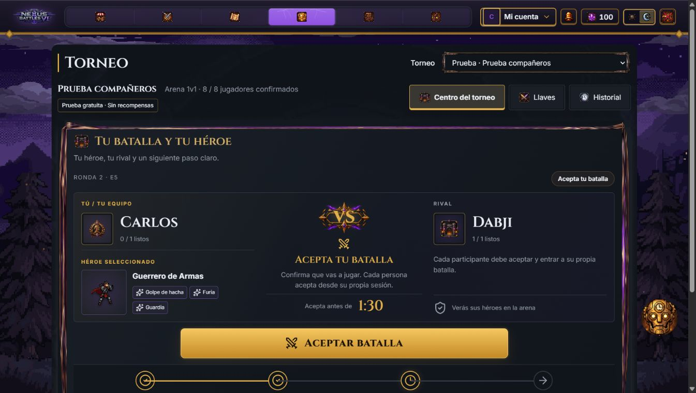
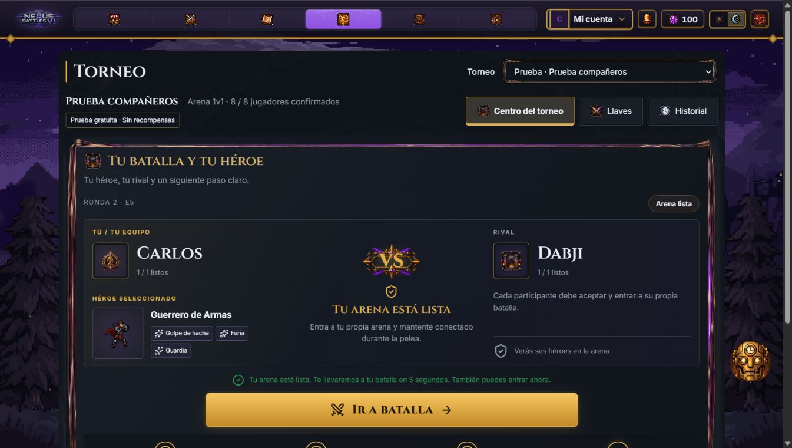
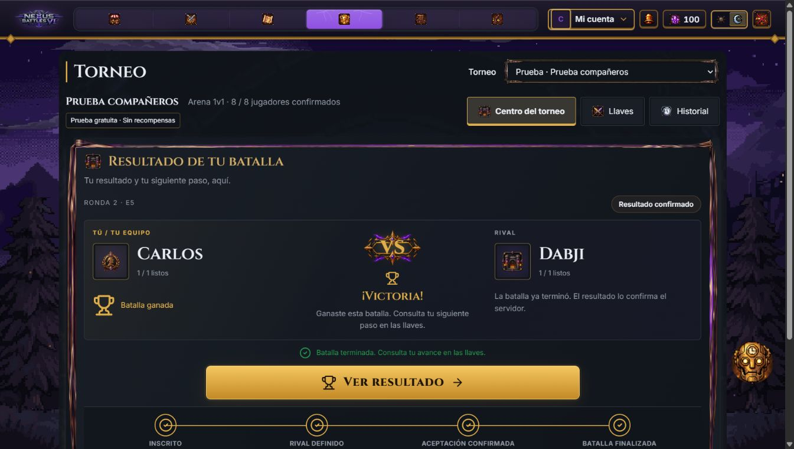

# Centro del torneo: batalla personal

El centro reúne el héroe seleccionado, el rival y una instrucción principal. La navegación general queda en Centro del torneo, Llaves e Historial; inscripción, premios y transmisión pasan a opciones secundarias.

Estas son capturas del bundle productivo ejecutado localmente a 1360 × 768 con respuestas HTTP de demostración. Los nombres, héroe, habilidades y resultados ilustran estados; no acreditan un despliegue ni un torneo jugado por personas reales. El servidor de demostración y sus controles quedan fuera del bundle y del código de producción.

## Esperando rival

Se consulta la dependencia de la otra plaza dentro del mismo torneo. Se muestran sus participantes cuando están disponibles, sin prometer una hora de resolución. Inscripción está completada y Definiendo rival es el paso actual. No hay botón de aceptación ni de entrada.

## Aceptar batalla

La cuenta regresiva usa la hora sincronizada del servidor. El botón envía únicamente el intento de la persona autenticada, mantiene su idempotencia y comprueba el recibo. Conocer una sala o recibir el comprobante de otra persona no habilita la entrada.

## Entrar a la arena

La sala y la aceptación pertenecen al mismo sujeto, equipo, torneo y encuentro. La entrada automática espera cinco segundos para permitir leer el aviso; el enlace permite entrar de inmediato. La gracia de Combat permanece en dos minutos.

## Resultado

Una victoria solo se presenta con ganador confirmado. Un combate finalizado sin confirmación conserva el mensaje de comprobación. No se proclama un campeón al ganar una batalla. Las ausencias conservan su explicación y no muestran pasos de combate completados ficticios.

## Verificación

- Pruebas de la funcionalidad de torneos, selección de héroe, errores de inventario, reloj, recibos, sala personal, espera de cinco segundos y resultado pendiente/confirmado.
- El héroe y las habilidades se consultan en el inventario del JWT; no se inventan preparación, héroes del rival ni metadatos de una instancia UUID. Un fallo de consulta ofrece revisar Inventario.
- Revisión visual a 1360 × 768 y comprobación móvil a 390 × 844. En móvil la instrucción antecede a las tarjetas de los participantes.
- Compilación, tipos, lint y verificación de bundle sin marcadores de desarrollo.

El recorrido integrado anterior de ocho sesiones y catorce batallas verifica el motor y el avance; estas capturas posteriores verifican la interfaz. Son evidencias distintas.
