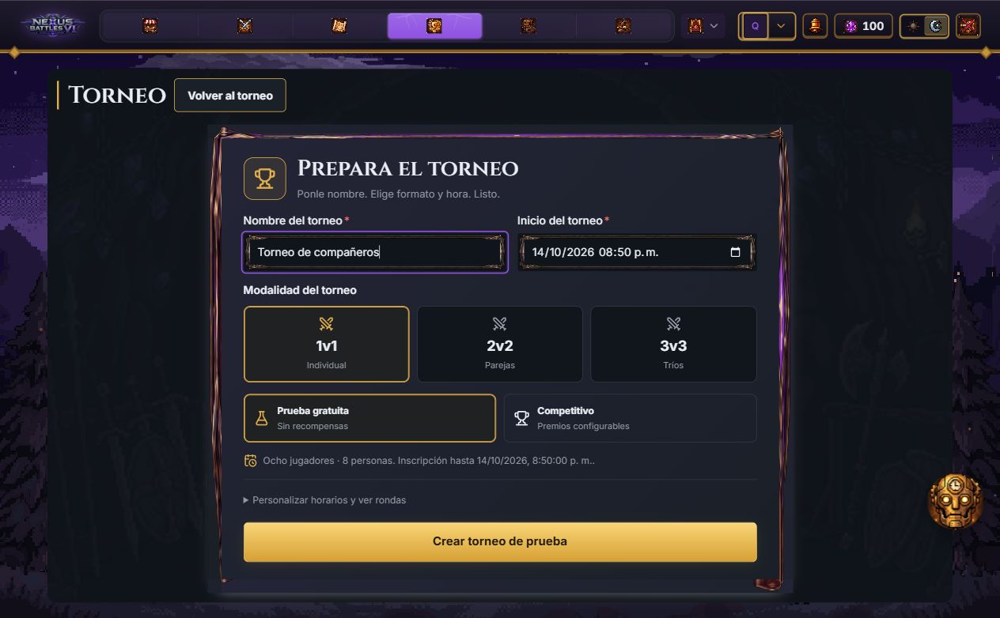
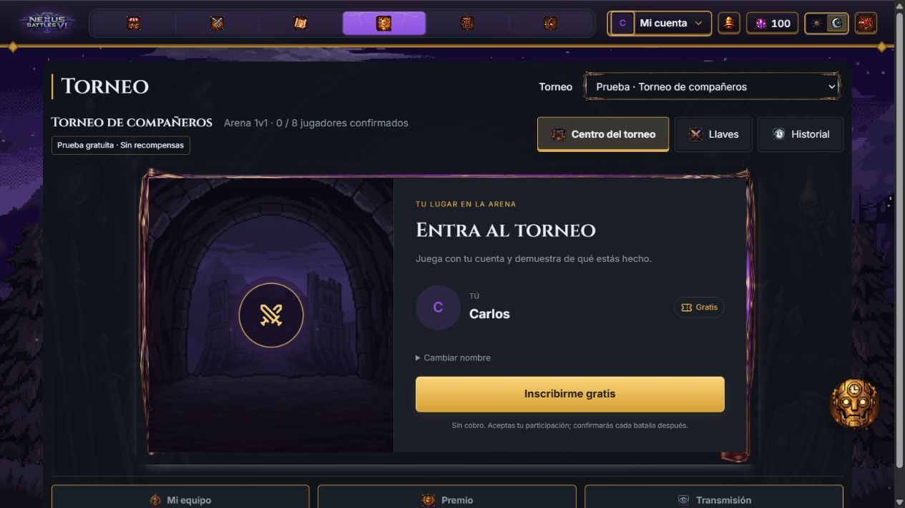
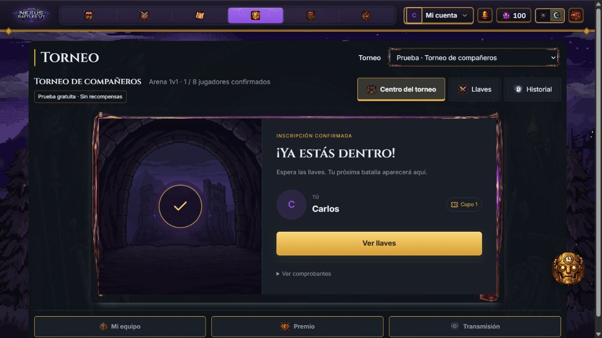
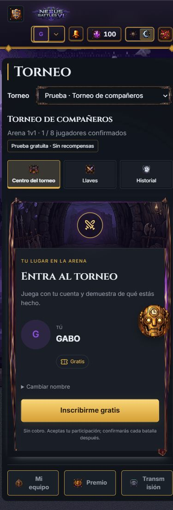
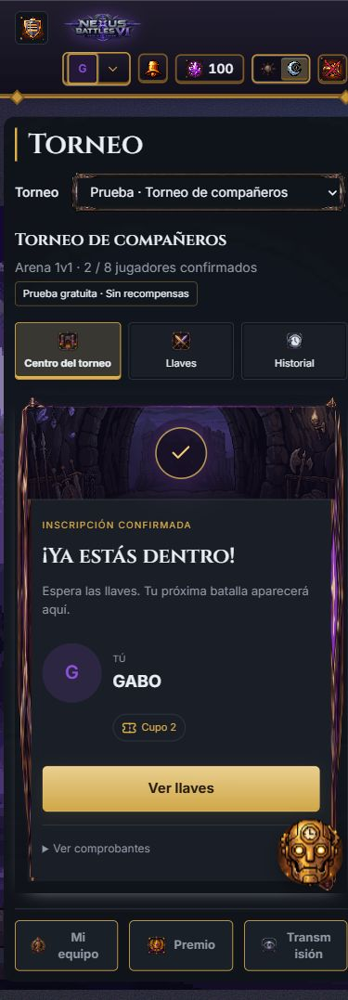
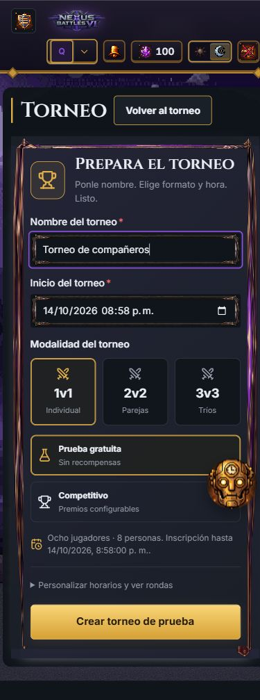

# Creación e inscripción simplificadas

Capturas reales del bundle productivo en el entorno local, 14 de octubre de 2026.

- Crear: nombre, inicio y formato. Prueba gratuita seleccionada y opciones avanzadas cerradas. El administrador puede elegir un torneo competitivo y configurar el precio explícitamente.
- Inscripción 1v1 gratuita: nombre de cuenta, avatar y una acción, **Inscribirme gratis**. Registra y confirma el cupo con dos operaciones idempotentes independientes. Cambiar nombre es opcional.
- Confirmación: **Ya estás dentro**, cupo y siguiente paso. Comprobantes bajo demanda. No se anuncia confirmación antes de recibir el comprobante del servidor.
- Parejas, tríos y pagos conservan sus consentimientos y confirmaciones individuales.

## Verificación y límites

- 178 pruebas locales en 17 archivos: registro, precio, horarios, reintentos sin duplicación, respuesta perdida en cada operación, cambio de cuenta, aforo y flujo de batalla.
- ESLint de los archivos modificados, tipos, build y verificación del bundle sin marcadores DEV.
- Creación e inscripción ejecutadas desde la interfaz contra Tournament y PostgreSQL locales. Carlos y GABO recibieron sus propios cupos gratuitos 1 y 2. No se jugaron nuevas batallas para estas capturas.
- En móvil 390 × 844, creación e inscripción tienen ancho de documento de 390 px, sin desbordamiento horizontal.
- JWT, Account, Inventory y Wallet son dobles de QA. Las capturas no acreditan un despliegue, un cobro real ni validación de usabilidad con personas.

La captura de creación utiliza los valores iniciales de la hora del navegador; al abrir el formulario de nuevo cambia la hora sugerida. El servidor conserva el horario del torneo que se creó.
